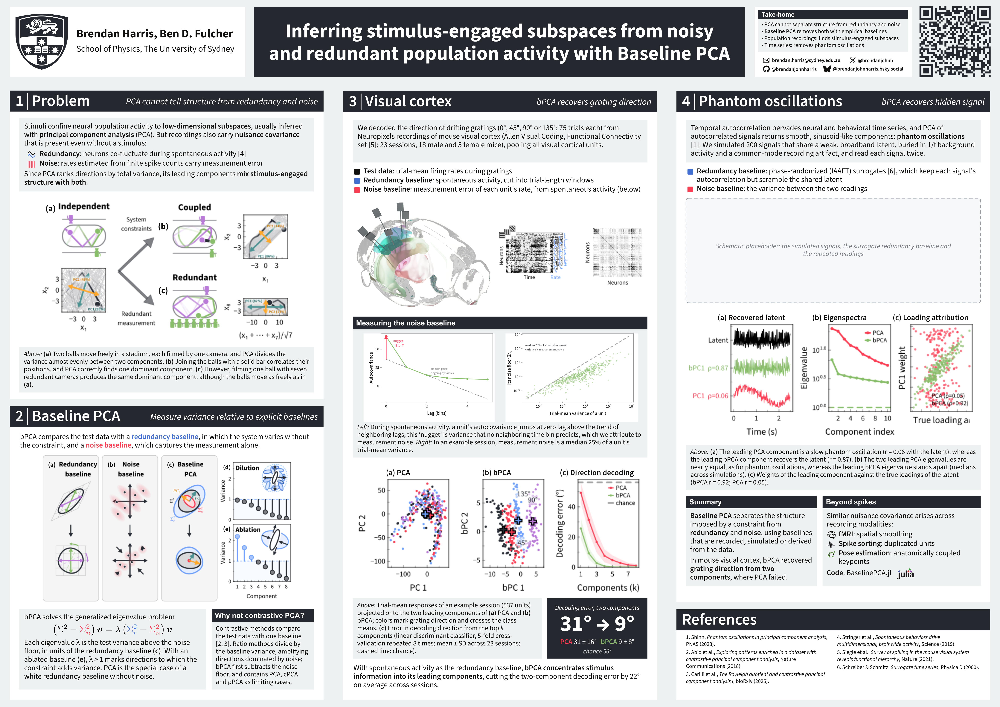

# SfN_2026
Poster file for "_Inferring stimulus-engaged subspaces from noisy and redundant population activity with Baseline PCA_" (Brendan Harris and Ben Fulcher, School of Physics, The University of Sydney), presented at Neuroscience 2026 in Washington, DC (late-breaking poster LBP076.24, board C25; Wednesday 18 November, 8 am to 12 pm, presenting 11 am to 12 pm).

The poster comes as a PDF (`SfN_2026.pdf`), a PNG preview (`SfN_2026.png`) and a self-contained SVG (`SfN_2026.svg`). The scripts and figure sources that build it are on the `dev` branch.

## Contact
✉️: brendan.harris@sydney.edu.au

💻: [github.com/brendanjohnharris](https://github.com/brendanjohnharris)

🦋: [@brendanjohnharris.bsky.social](https://bsky.app/profile/brendanjohnharris.bsky.social)

