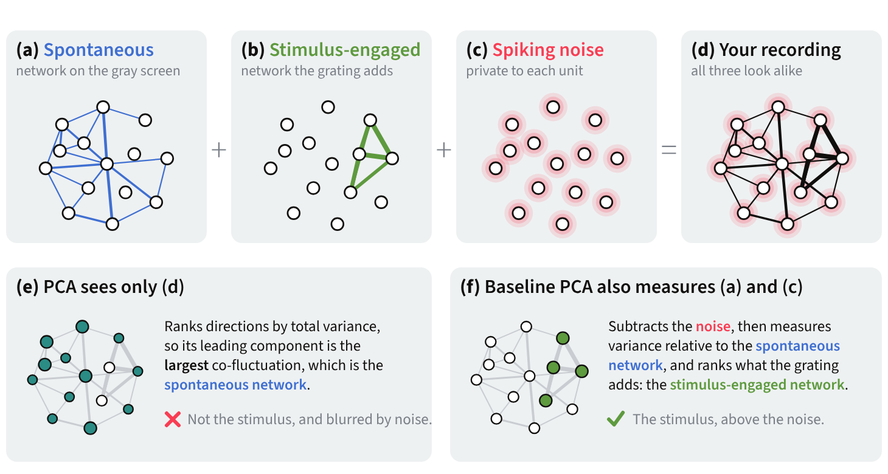
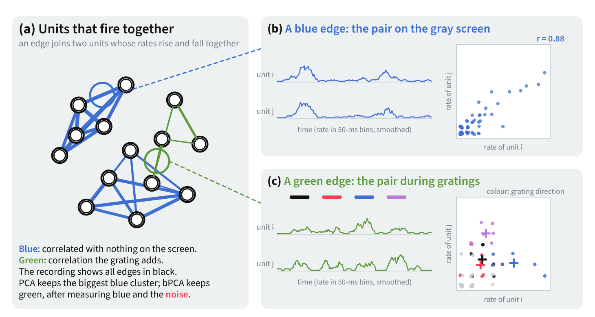
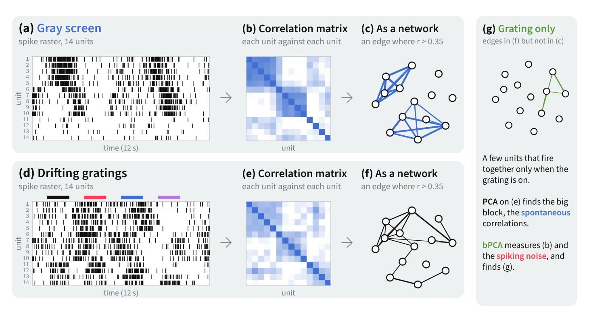
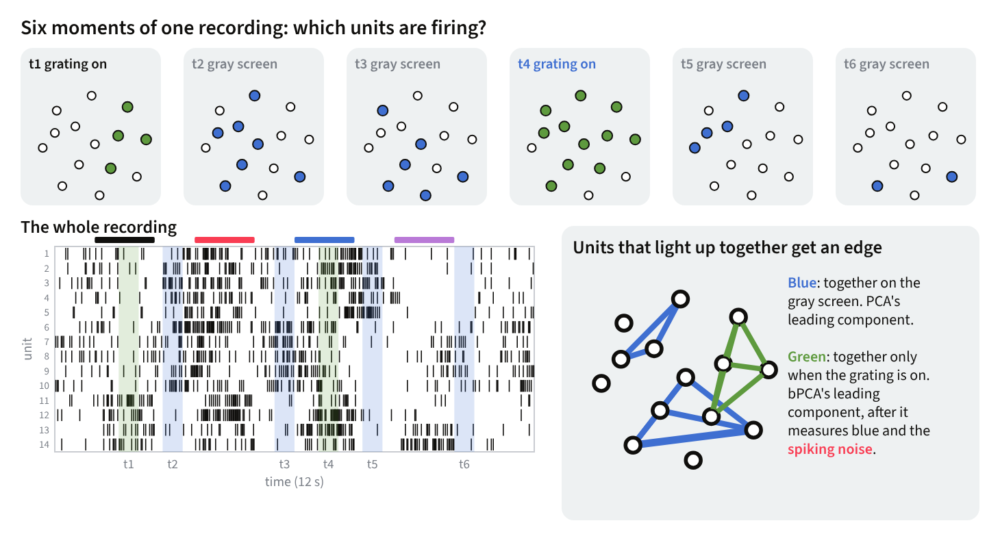
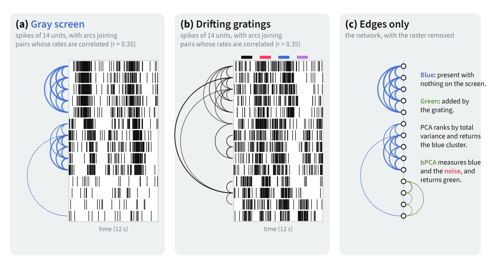
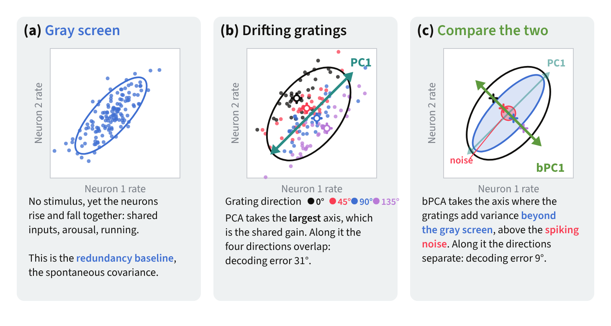
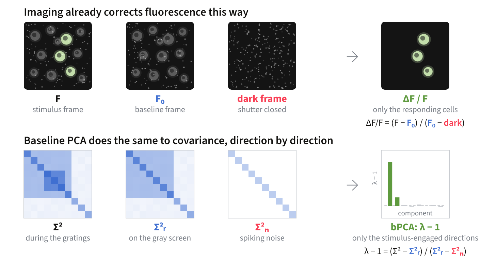
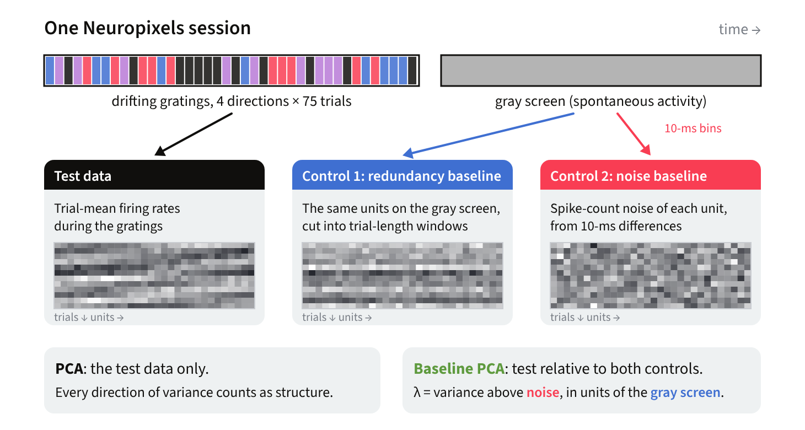
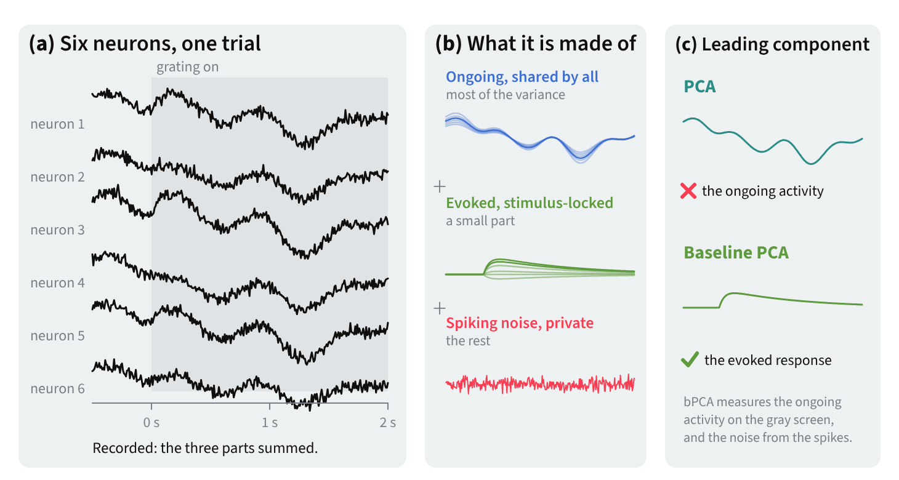

# Five ways to open the poster (Section 1 drafts)

Drafts for the first column of `SfN_2026.svg`: five different framings of the problem, each with its
own schematic, lead text, caption, and hand-off to Section 2. Nothing here is wired into the poster yet.

Files: `optionN-*.svg` (1460 x 780 poster units, drawn to drop into the Section 1 figure slot at
k = 0.93), `preview/optionN-*.png` (renders), `make_drafts.py` + `svgkit.py` (generator for options
1–5), `make_variants.py` (the four network variants 1b–1e, from simulated spikes), `render.js` (SVG
to PNG with the pre-installed Playwright Chromium), `build_page.py` (the comparison page).
Regenerate with `python3 make_drafts.py && python3 make_variants.py && node render.js preview 1 option*.svg`.

## What the opening has to do

A neuroscientist gives the first column about thirty seconds. In that time it has to do three things:

1. Make them feel the problem in their own terms: the leading principal components of a population
   recording are usually not the stimulus.
2. Name the two nuisance sources in words they already use. The paper calls them *redundancy*
   (neurons co-fluctuate without a stimulus) and *noise* (spike counts are finite). Neither word is
   what a neuroscientist would say first.
3. Set up the two baselines, so that Section 2's "redundancy baseline" and "noise baseline" land as
   names for things the reader has already seen, not as new vocabulary.

The current opening (two balls in a stadium filmed by cameras) is a clean thought experiment, but it
costs the reader four translations before the point lands: balls are neurons, cameras are recorded
units, the rod is the stimulus, the seven redundant cameras are shared inputs. Every option below
removes those translations by drawing the problem directly in neural data.

Each option replaces the figure in the slot (1362 x 779 poster units) and the lead paragraph above
it. Section 2 stays as it is, apart from the one hand-off sentence noted under each option.

---

## Option 1. Two networks on top of each other (your idea)

**Subtitle for the section header:** *Your recording is two networks on top of each other*

**How a neuroscientist reads it, left to right.**

1. Panel (a) is a network. The dots are units and a line between two units means "these two fire
   together". It is blue and labelled *gray screen*, and everyone knows the gray-screen epoch is the
   part of the session with nothing happening. So these lines are co-fluctuations that have nothing
   to do with the stimulus: shared inputs, arousal, running.
2. Panel (b) is a second, smaller and tighter network in green: the links the grating adds. Two of
   its units also belong to the blue ring in (a). The same neurons carry both networks; that is
   what makes the problem hard.
3. Panel (c) has no lines at all, only red halos: spiking noise is private to each unit, so it links
   nothing, but it blurs everything.
4. Panel (d) is the sum, drawn in black on purpose: in the recording nothing tells you which line
   came from which network. Thick lines are where a blue and a green link coincide.
5. Panel (e): PCA sees only (d). It ranks directions by total variance, so its leading component (the
   teal units) is the largest co-fluctuation, which is the spontaneous network.
6. Panel (f): Baseline PCA has also measured (a) and (c). It subtracts the noise, measures variance
   relative to the spontaneous network, and returns the green module.

**Lead text** (replaces the intro box):

> A population recording is a network: units that fire together are linked. Most links are there
> with nothing on the screen (shared inputs, arousal, running), and every unit also carries its own
> spiking noise. The stimulus adds a smaller network on top. PCA ranks directions by total variance,
> so it returns the biggest network first: the spontaneous one.

**Caption:**

> (a) On a gray screen, units already co-fluctuate: the spontaneous network. (b) A grating engages a
> smaller set of units, some of which also belong to the spontaneous network. (c) Finite spike counts
> add private noise to every unit. (d) The recording is the sum, and the three parts look alike.
> (e) PCA ranks directions by total variance, so its leading component is the largest
> co-fluctuation, the spontaneous network. (f) Baseline PCA measures (a) and (c) directly, and
> ranks what the grating adds beyond them.

**Hand-off to Section 2.** "The spontaneous network" becomes the redundancy baseline and "the spiking
noise" becomes the noise baseline. Section 2's first sentence would read: "bPCA compares the test
data with a redundancy baseline (the spontaneous network, recorded on the gray screen) and a noise
baseline (the spiking noise)."

**Strengths.** Visually the most distinctive of the five, and "functional connectivity" is a frame
neuroscientists already hold. It makes the key difficulty visible: the same units carry both
networks. Panel (d) in black says "indistinguishable" without a word. Colouring the units by their
loading in (e) and (f) is exactly what a component is (a weight per unit), so the picture also
teaches what bPCA returns.

**Risks.** A network implies pairwise links, but a component is a pattern of loadings; a reader may
walk away thinking bPCA is a connectivity method. Saying "co-fluctuation network" once in the lead
text, and colouring nodes rather than edges in (e) and (f), limits this. Six panels is dense for the
slot: at poster size the explanatory sentences in (e) and (f) should move to the caption box, leaving
one short line each.

---

## Option 1, made explicit: four variants where an edge is visibly a correlation

The network in Option 1 is drawn by hand, so nothing in it says what a line *is*. These four variants
keep the whole-system view but build the network from spiking data, so the reader can see that an
edge joins two units whose firing rates rise and fall together.

All four come from one simulated population (`make_variants.py`): 14 units, 12 s at 50 ms bins,
Poisson spikes. Units 1–10 belong to two spontaneous groups that share a hub unit, each group driven
by its own slow fluctuation (arousal, running). Units 11–14 are a module tuned to grating direction;
two of them also lean weakly on the first group, so the same neurons carry both. Correlations are
Pearson r between rates in 150 ms windows, and an edge is drawn where r > 0.35. Change the seed or
the thresholds at the bottom of `make_variants.py` and rerun to get a different draw.

### 1b. An edge, exploded into the pair's data

**Subtitle:** *An edge is two units whose rates rise and fall together*

**How it reads.**

1. Panel (a) is the network, now in its true colours: two blue groups (correlated with nothing on the
   screen) and a green module (correlation the grating adds). A magnifier sits on one blue edge and
   one green edge.
2. Panel (b) opens the blue edge. The two units' rates over 12 s of gray screen bump at the same
   moments, and their rates in 200 ms windows, plotted against each other, make a tilted cloud:
   r = 0.88. That is all an edge is.
3. Panel (c) opens the green edge. During gratings the two units burst under the stimulus bars, and
   the scatter, coloured by direction, pulls the four directions apart; the windows with no grating
   (grey) sit near the origin. A green edge is covariance the grating creates, and it carries the
   direction.

**Lead text:**

> Draw a line between any two units whose firing rates rise and fall together, and a population
> recording becomes a network. Most of its lines are there with nothing on the screen: shared
> inputs, arousal, running. The grating adds a few more, among the units it drives. PCA, which ranks
> directions by total variance, returns the biggest cluster of lines, which is not the stimulus.

**Caption:**

> (a) Units linked when their rates are correlated: blue on the gray screen, green only during
> gratings. (b) One blue edge: the pair's rates on the gray screen and their joint distribution
> (r = 0.88). (c) One green edge: the pair's rates during gratings, and their joint distribution
> coloured by direction (crosses: class means; grey: no grating). The recording draws every edge in
> black. bPCA measures the blue network and the spiking noise, and ranks what the grating adds.

**Hand-off to Section 2.** Panel (b) is the redundancy baseline seen for one pair; the ellipse of
(c) beyond the ellipse of (b) is what bPCA ranks; the noise baseline is the jitter of each dot that
would remain if the rates were held fixed. Panel (c) is also Section 3's panel (g) for two units.

**Strengths.** Answers "what is an edge?" with the plot every electrophysiologist uses, and merges
Option 1 (the whole system) with Option 2 (one pair). The green scatter previews the decoding result.

**Risks.** The busiest of the network variants: two callouts compete with the network, and at poster
scale they need the full slot height. The magnified pairs must be chosen so their traces look clean.

### 1c. Spike raster, correlation matrix, network

**Subtitle:** *Correlations that are there with nothing on the screen*

**How it reads.**

1. Panel (a) is a raster of 14 units on the gray screen. Dense vertical bands show groups of units
   firing together, at moments that have nothing to do with a stimulus.
2. Panel (b) is the correlation matrix of their rates. The two bands become two blocks (units 1–6
   and 6–10, sharing unit 6).
3. Panel (c) draws the matrix as a network: an edge wherever r > 0.35. Two clusters, and that is
   everything the matrix said.
4. Panels (d)–(f) repeat this during gratings. The bands are still there, units 11–14 now burst at
   every grating, the matrix gains a third block, and the network gains a clique, drawn in black like
   every other edge because the recording does not label them.
5. Panel (g) keeps only the edges of (f) that are not in (c): the few units that fire together only
   when the grating is on.

**Lead text:**

> Correlate every unit with every other unit and a recording becomes a matrix, and the matrix a
> network. On a gray screen the matrix already has blocks: groups of units that rise and fall
> together under shared inputs, arousal and running. A grating adds one block more. PCA diagonalises
> the whole matrix, so its leading components are the biggest blocks, which were there without the
> stimulus.

**Caption:**

> (a)–(c) Gray screen: spike raster, correlation matrix of the rates, and the matrix as a network
> (edge where r > 0.35). (d)–(f) The same during drifting gratings (bars: direction). (g) Edges
> present in (f) but not in (c). PCA on (e) returns the large blocks, the spontaneous correlations.
> bPCA measures (b) and the spiking noise, and returns (g).

**Hand-off to Section 2.** Matrix (b) *is* the redundancy baseline Σ²ᵣ and matrix (e) is Σ²; nothing
is renamed. The noise baseline is what each unit's diagonal entry holds beyond the trend of its
neighbouring lags (Section 3's nugget), so Section 3's noise box follows naturally.

**Strengths.** Nothing is metaphorical: the raster is the data, the matrix is the covariance that
PCA and bPCA actually consume, and the network is only the matrix thresholded. The block structure
explains "redundancy" even to a physicist. Panel (g) is the stimulus-engaged subspace as a picture.

**Risks.** Seven panels. For matrix-literate readers the network adds little over the matrix.
Rasters print badly when small: at poster scale the bins must stay at least a point wide.

### 1d. Units that light up together get an edge (flipbook)

**Subtitle:** *Fire together, wire together, even with nothing on the screen*

**How it reads.**

1. Six snapshots of the same 14 units at six moments of one recording; a filled dot is a unit firing
   in that half second. At the gray-screen moments one group lights up together, or the other. At
   the grating moments a different group of four lights up.
2. The raster underneath shows where the six moments sit, so the snapshots are visibly taken from the
   data.
3. On the right, every pair that lit up together in two or more gray-screen moments gets a blue
   edge; pairs that lit up together only during gratings get a green one. The network is assembled in
   front of the reader.

**Lead text:**

> Watch a population for a few seconds and the same groups of units keep lighting up together, with
> nothing on the screen. Link every pair that does, and you have a network that owes nothing to the
> stimulus. A grating lights up one more group. PCA ranks directions by total variance, so its leading
> component is the group that lights up most, not the one the grating drives.

**Caption:**

> Top: six moments of one recording (filled: units firing in that 0.5 s; green frames fall during a
> grating). Bottom left: the recording, with the six moments marked. Bottom right: pairs that lit up
> together at two or more gray-screen moments (blue) and pairs that lit up together only during
> gratings (green). bPCA measures the blue network and the spiking noise, and returns green.

**Hand-off to Section 2.** The blue network, assembled from gray-screen moments, is the redundancy
baseline; the green edges are what bPCA ranks; the noise baseline is a dot that flickers on alone.

**Strengths.** The most self-explanatory of all the drafts: a passer-by can rebuild the network from
the frames, and "together, repeatedly" is exactly what the covariance of binned counts measures.
The Hebbian slogan is a hook every neuroscientist knows, and the twist (the wiring is there without
a stimulus) is the message.

**Risks.** "Wire together" may suggest synaptic plasticity; say "edge", not "wire", in the body text.
The lit sets are Poisson-noisy, which is realistic, but a passer-by may count mismatches. Six frames
plus a raster is wide; it fits the slot only with small frames.

### 1e. Arcs over the raster

**Subtitle:** *The network, drawn on the data*

**How it reads.**

1. Panels (a) and (b) are the two rasters of 1c, but the network is drawn directly on them: an arc
   joins two rows whose rates are correlated. On the gray screen the arcs form two bundles.
2. During gratings the bundles stay and new arcs appear among the four bottom rows.
3. Panel (c) removes the raster and keeps the arcs: blue for the gray screen, green for what the
   grating added.

**Lead text:** as 1c.

**Caption:**

> (a) Gray screen: spikes of 14 units, with an arc joining each pair whose rates are correlated
> (r > 0.35). (b) The same during drifting gratings. (c) The arcs alone: present on the gray screen
> (blue) and added by the grating (green). PCA returns the blue bundles; bPCA measures them and the
> spiking noise, and returns green.

**Strengths.** One picture holds the data and the network, and it is compact enough to share the slot
with text. "Same rows, more arcs" is obvious at a glance.

**Risks.** Arc diagrams are less familiar than node-link drawings. Chance correlations produce stray
long arcs (one in (a)) that need pruning or a word of explanation.

### Choosing among the network variants

- **1c** is the safest: every element is a real analysis object, and its matrices are literally
  Σ²ᵣ and Σ². Best for an electrophysiology crowd.
- **1d** is the most memorable and the only one that teaches what an edge means without a scatter
  plot or a matrix. Best if the network has to carry the whole column on its own.
- **1b** is the best bridge to the state-space picture (Option 2) and to Section 3's scatter panels.
- **1e** is the most compact, at the cost of an unfamiliar drawing.

If the opening is to be a network, use **1d** as the figure, with its slogan as the header subtitle,
and reuse 1c's two matrices (b) and (e) beside Section 2's equation, where they become Σ²ᵣ and Σ²
without renaming.

---

## Option 2. Two neurons in state space

**Subtitle:** *The largest axis of variance is rarely the stimulus*

**How it reads.**

1. Panel (a) plots the firing rate of one unit against another during the gray screen. Everyone has
   drawn this plot; it is the noise-correlation scatter. The cloud is tilted, which says the two units
   rise and fall together without any stimulus.
2. Panel (b) is the same plot during gratings, coloured by grating direction. The tilt is still there
   (the shared gain did not go away) and the four directions are displaced *across* the tilt, because
   the two units prefer different directions. PC1, in teal, runs along the tilt: it is the largest axis,
   and along it the four colours overlap completely.
3. Panel (c) lays the two covariance ellipses on top of each other. The black ellipse (gratings)
   sticks out beyond the blue ellipse (gray screen) in only one direction, across the tilt. That is
   bPC1. The red disc at the centre is the spiking noise that both ellipses contain; it is subtracted
   before the two are compared.

**Lead text:**

> Plot two units against each other and they rise and fall together even on a gray screen: shared
> inputs, arousal and running give the population a large axis of variance that has nothing to do
> with the stimulus. A grating adds variance along a different axis, where the units' tuning differs.
> PCA takes the largest axis. Baseline PCA takes the axis where the stimulus adds variance beyond the
> gray screen, above the spiking noise.

**Caption:**

> (a) Firing rates of two units during spontaneous activity: the cloud is tilted because the units
> co-fluctuate. (b) During drifting gratings the tilt remains and the four directions (colours;
> crosses mark class means) separate across it. PCA takes the largest axis, PC1, along which the
> directions overlap. (c) Baseline PCA compares the two covariance ellipses after subtracting the
> spiking noise (red), and takes the axis where the gratings add variance beyond the gray screen:
> bPC1, along which the directions separate. In a population this happens in hundreds of dimensions
> at once (Section 3).

**Hand-off to Section 2.** The blue ellipse is the redundancy baseline Σ²ᵣ and the red disc is the
noise baseline Σ²ₙ; the eigenvalue of a direction is how far the black ellipse sticks out beyond the
blue one, in units of the blue, after both lose the red. This is already Section 2's panel (c), so that
panel could shrink or go, giving Section 2 more room for dilution/ablation and the equation.

**Strengths.** The most familiar picture in population coding, so there is nothing to translate. The
decoding numbers (31° to 9°) sit inside the figure, and the panels preview Section 3's own panels
(f)–(h), so the poster reads as one story. The red disc also explains why the noise baseline exists:
a direction in which both ellipses are as thin as the disc would blow up if you divided by the
baseline alone.

**Risks.** It is the two-neuron cartoon every method paper uses, so it is the least surprising.
Redundancy appears only as "co-fluctuation", so the word "redundancy" in Section 2 still needs one
line of translation. The schematic assumes the spontaneous covariance persists unchanged during the
stimulus; Section 2(e) already covers the case where the stimulus quenches it (λ < 1).

---

## Option 3. ΔF/F for covariance

**Subtitle:** *Baseline-correct the covariance, not just the fluorescence*

**How it reads.**

1. Top row: a frame during the stimulus (F), the baseline frame (F₀), the dark frame with the
   shutter closed, and the result, ΔF/F, which shows only the cells that responded. Every imager
   does this before looking at anything else.
2. The formula under the row is the one they know: ΔF/F = (F − F₀) / (F₀ − dark). The dark frame is
   removed from both before the ratio.
3. Bottom row: the same three objects, but for covariance. Σ² during the gratings has a block of
   shared covariance plus a tuned sub-block; Σ²ᵣ on the gray screen has the shared block only;
   Σ²ₙ, the spiking noise, is a diagonal. The result is not a matrix but a spectrum: λ − 1 for each
   direction, which is zero except for the directions where the stimulus adds covariance.
4. The formula under it is the same formula with the symbols swapped:
   λ − 1 = (Σ² − Σ²ᵣ) / (Σ²ᵣ − Σ²ₙ), one direction at a time. That is what the generalized eigenvalue
   problem in Section 2 computes (rearrange (Σ² − Σ²ₙ) v = λ (Σ²ᵣ − Σ²ₙ) v along v).

**Lead text:**

> No imager reports raw fluorescence: F is read relative to a baseline F₀, after the camera's dark
> frame is subtracted. PCA reports raw variance. Baseline PCA reads the variance of each direction
> the same way: relative to spontaneous activity (the baseline), after subtracting spiking noise
> (the dark frame). Directions where the stimulus adds nothing come out at zero, like a cell that did
> not respond.

**Caption:**

> Top: ΔF/F compares a stimulus frame F with a baseline frame F₀ after removing the dark frame; only
> responding cells remain. Bottom: Baseline PCA compares the covariance during gratings, Σ², with the
> covariance on the gray screen, Σ²ᵣ, after removing the spiking-noise covariance Σ²ₙ. The eigenvalue
> λ − 1 of a direction is its ΔF/F, so only stimulus-engaged directions remain.

**Hand-off to Section 2.** F₀ is the redundancy baseline, the dark frame is the noise baseline, and
λ − 1 is ΔF/F. Section 2's sentence "λ > 1 marks directions to which the constraint adds variance"
becomes "ΔF/F > 0". The equation box could carry a one-line gloss: "λ − 1 is ΔF/F for covariance".

**Strengths.** The parallel is exact, not a metaphor, so nothing has to be unlearned later. It is
instant for imagers and familiar to electrophysiologists (baseline subtraction, normalisation). It is
the only option that makes the *noise* baseline obvious by itself: everyone knows why the dark frame
is subtracted. It also makes the eigenvalue readable (λ = 1 means "same as baseline").

**Risks.** "One direction at a time" carries the subtlety: ΔF/F is pixel-wise, bPCA is a generalized
eigenproblem, and a careful reader will ask which directions (answer: the ones the equation picks).
It does not show *why* PCA fails on its own; there is no largest-axis picture. A Neuropixels crowd
that never computed ΔF/F gets less from it. It pairs well with Option 2.

---

## Option 4. Give PCA a control condition

**Subtitle:** *PCA has no control condition. Your recording already contains two.*

**How it reads.**

1. A session timeline, like the stimulus-epoch strip in the Allen protocol: a gratings block
   (coloured stripes, one per trial) and a gray-screen block.
2. Three cards are pulled out of it. The test data are the gratings. Control 1 is the gray screen:
   the same units with no stimulus, which is what the stimulus is compared against. Control 2 is the
   spike-count noise: the same units, read at 10 ms, so that rate changes cancel in successive
   differences and only counting noise remains.
3. Below: PCA uses the first card only. Baseline PCA uses all three and reports λ, the variance above
   the noise, in units of the gray screen.

**Lead text:**

> No experiment is reported without a control, but PCA has none: every direction of variance counts
> as structure, including the co-fluctuations that are there with nothing on the screen and the
> noise in every spike count. Baseline PCA adds two controls that your recording already contains:
> the gray-screen epoch, which keeps the shared inputs but removes the stimulus, and the spike-count
> noise, which keeps the measurement but removes the activity.

**Caption:**

> One Neuropixels session provides all three inputs. Test data: trial-mean rates during gratings.
> Control 1 (redundancy baseline): the same units on the gray screen, cut into trial-length windows.
> Control 2 (noise baseline): the counting noise of each unit's rate, from differences of 10-ms spike
> counts, in which rate fluctuations cancel. PCA uses the test data only; Baseline PCA reports, for
> each direction, the test variance above the noise in units of the control.

**Hand-off to Section 2.** Control 1 is the redundancy baseline, control 2 the noise baseline. The
word "control" stays useful later: the IAAFT surrogate is the control for phantom oscillations
(Section 4) and the second reading is its noise control.

**Strengths.** It speaks to an experimentalist's reflex (where is the control?), and it sells
feasibility: no new experiment, the baselines are already in the session. It doubles as the
methods strip for Section 3, whose Test / Redundancy / Noise list could then shrink. The 10-ms
differencing story, which otherwise arrives late in the nugget box, appears up front.

**Risks.** The least visual option: it does not show *why* PCA fails, only what bPCA takes in.
"Control" may suggest subtracting means rather than comparing covariances. It works best as a strip
beneath one of the other figures, or as the header of Section 3.

---

## Option 5. Evoked responses ride on ongoing activity

**Subtitle:** *Evoked responses ride on ongoing activity that is larger than they are*

**How it reads.**

1. Panel (a): six raw traces across one trial with grating onset marked. They all wobble together,
   slowly, and some show a small step at onset. This is the Arieli (1996) and Stringer (2019) picture:
   ongoing activity is large and shared.
2. Panel (b) separates the traces into three parts: ongoing (blue; one waveform, scaled per unit),
   evoked (green; stimulus-locked, different per unit) and spiking noise (red). The grey badges say
   where the variance is: mostly in the ongoing part.
3. Panel (c): the leading component of PCA is the ongoing waveform; the leading component of Baseline
   PCA is the evoked one.

**Lead text:**

> Ongoing activity is not silence: large fluctuations shared across the population continue through
> every trial [Arieli 1996; Stringer 2019], and a stimulus adds a smaller, structured response on top.
> PCA ranks directions by variance, so its leading components follow the ongoing activity. Baseline
> PCA measures the ongoing activity when no stimulus is shown, and the spiking noise, and ranks what
> the stimulus adds.

**Caption:**

> (a) Six units in one trial: the slow fluctuations are shared, the responses at grating onset are
> small and differ between units. (b) The three parts: ongoing activity (shared; most of the
> variance), evoked response (stimulus-locked), spiking noise (private). (c) PCA's leading component
> follows the ongoing activity; Baseline PCA's follows the evoked response.

**Hand-off to Section 2.** Ongoing activity is the redundancy baseline, spiking noise the noise
baseline. It also previews Section 4: autocorrelated background activity is what produces phantom
oscillations.

**Strengths.** The premise is already believed (nobody at SfN doubts that ongoing activity is large),
so the argument is short. It is the only option in the time domain, which is how most people picture
their data, and it bridges to Section 4.

**Risks.** Section 3's test data are trial-mean rates, not time courses, so this picture is an
intuition rather than the analysis: across trials, the trial-mean of the ongoing activity varies and
still dominates the covariance. Label (a) "one trial of many" or say so in the caption. Because the
premise is familiar, the figure is the least surprising of the five.

---

## Side by side

| | First thought | Teaches in ten seconds | Sets up Section 2 words as | Visual novelty | Main risk |
|---|---|---|---|---|---|
| 1 Networks | "functional connectivity" | the recording is two networks plus noise; PCA picks the bigger | spontaneous network / spiking noise | high | reads as a connectivity method |
| 1b Zoom | "an edge is a correlation" | the whole system, and one pair opened up | pair scatter on gray screen / dot jitter | medium | busy |
| 1c Raster to network | "that's my raster" | gray screen already has blocks; the grating adds one | matrix (b) is Σ²ᵣ | medium | seven panels |
| 1d Flipbook | "fire together, wire together" | units that light up together get an edge, stimulus or not | blue network / lone flicker | high | slogan suggests plasticity |
| 1e Arcs | "network on the raster" | same rows, more arcs | blue arcs / noise | medium | unfamiliar drawing |
| 2 State space | "noise-correlation scatter" | PC1 is the shared gain; the stimulus is across it | blue ellipse / red disc | low | the standard cartoon |
| 3 ΔF/F | "that's ΔF/F" | λ − 1 is ΔF/F for covariance | F₀ / dark frame | medium | does not show why PCA fails |
| 4 Control | "where is the control?" | the baselines are already in the session | control 1 / control 2 | low | not a picture of the problem |
| 5 Ongoing | "Arieli, Stringer" | evoked rides on ongoing; PCA follows ongoing | ongoing activity / spiking noise | medium | time domain is not the analysis |

## Recommendation

Use **Option 2 as the figure**, with **Option 4 reduced to a one-line strip** under it saying where
the three inputs come from. Reasons: it is the picture neuroscientists already use to think about
population coding, so there is nothing to translate; it previews Section 3's panels (f)–(h), so the
poster reads as one story from column 1 to column 2; and the headline numbers (31° to 9°) can sit in
the opening. Then borrow Option 3's gloss for Section 2's equation ("λ − 1 is ΔF/F for covariance,
one direction at a time"), which is the quickest way to make the eigenvalue mean something.

If the whole-system view matters more, which is the case Brendan made after the first round, take
the network family: **1d** as the figure (the slogan as subtitle, the frames teaching what an edge
is), with 1c's matrices reused beside Section 2's equation. Keep Option 2's panel (c) in Section 2,
where it already lives, so the two-neuron geometry still appears once.

A decision rule by audience: mostly systems electrophysiology, Option 2; mostly imaging, Option 3;
a crowd that asks "do I need new data?", Option 4; neighbours presenting spontaneous activity,
Option 5.

Hybrids that fit the slot:

- **2 + 4**: Option 2's three panels, plus Option 4's timeline as a 120-unit strip beneath them.
- **1 + 2**: Option 1's panels (a), (b), (d) as a top strip (what the recording contains), Option 2's
  panel (c) beside them (what the two methods do with it).
- **2 + 3**: Option 2 as the figure, Option 3's two formulas as the gloss beside Section 2's equation.

## Putting a draft into the poster

- The Section 1 slot is `x 209.6, y 1053.6, 1362 x 779` (the `rect275` placeholder). A draft is
  1460 x 780, so place it with `transform="matrix(0.933,0,0,0.933,209.6,1053.6)"`, or link it the way
  the other figures are linked (`<image>` inside a clipped group; see `figures/PROVENANCE.md`).
- At that scale the explanatory sentences inside the drafts (25–26 px) become about 23 poster units,
  which is small next to the poster's 40 px body text. For the real figure, keep only the short
  labels in the drawing (34 px and up) and move the sentences to the caption box, as the current
  cameras figure does.
- The drafts use Source Sans 3, like the poster. `render.js` needs the font installed locally
  (`fc-list | grep "Source Sans"`); without it Chromium falls back to a different sans and the line
  breaks shift.
- Colours follow the poster: test black `#100f0d`, redundancy blue `#3f6fd1`, noise red `#f93d53`,
  bPCA green `#5e9a3e`, grating directions as in Section 3.
